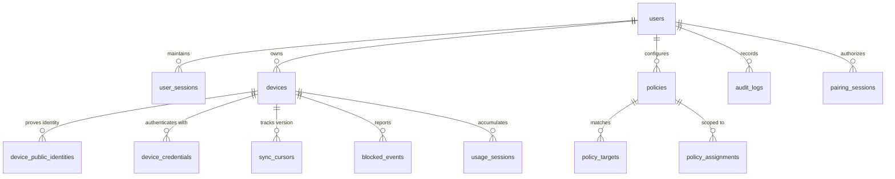

# FocusGuard Cloud Architecture Specification

```
                         FOCUSGUARD CLOUD

 ┌─────────────────────────────────────────────────────┐
 │                                                     │
 │                  API GATEWAY                        │
 │                                                     │
 │   ┌─────────────┬──────────────┬──────────────┐    │
 │   │             │              │              │    │
 │   ▼             ▼              ▼              ▼    │
 │ Auth        Device         Pairing        Policy   │
 │ Service     Service        Service        Service  │
 │                                                     │
 │   ┌─────────────┬──────────────┬──────────────┐    │
 │   ▼             ▼              ▼              ▼    │
 │ Event        Audit          Sync          Realtime │
 │ Service      Service        Service        Gateway │
 │                                                     │
 └──────────────────────────┬──────────────────────────┘
                            │
                            ▼
                      PostgreSQL / SQLite
```

---

## 1. System Overview

FocusGuard Cloud is structured as a **Modular Domain Service Architecture**. Each service owns a strict domain boundary, schema model, and contract interface while communicating through shared database transactions and real-time event distribution.

The cloud backend serves all client platforms:
- **WebExtensions**: Chrome, Brave, Edge, Firefox
- **Desktop Agents**: macOS (Swift / Screen Time), Windows (C# / WPF / Windows Filtering)
- **Mobile Clients**: Android (Kotlin / VpnService DNS Sinkhole)
- **Web Command Center**: Dashboard UI (HTML5 / Vanilla CSS / ES6)
- **Test Fleet Nodes**: `@focusguard/device-test-client`

---

## 2. Core Service Decomposition

### 2.1 API Gateway
- **Package Location**: `backend/cmd/server/main.go`, `backend/internal/middleware`
- **Responsibilities**:
  - Central HTTP routing, method dispatching, and protocol termination.
  - Strict CORS policy enforcement with exposed custom headers (`X-Request-ID`, `X-Policy-Version`, `ETag`).
  - Request ID tracing (`pkg/requestid`) attached to every context and propagated to response headers.
  - Granular in-memory rate limiting (`internal/middleware/rate_limit.go`) protecting authentication and pairing endpoints.
  - **AuthMiddleware**: Validates User JWTs for dashboard/owner operations.
  - **DeviceAuthMiddleware**: Validates Device JWTs, verifies credential versions, and rejects revoked devices at line rate.
  - **DeviceOrUserAuthMiddleware**: Dual-mode middleware supporting fleet nodes and dashboard operators.

### 2.2 Auth Service
- **Package Location**: `backend/internal/auth`
- **Key Tables**: `users`, `user_sessions`
- **Responsibilities**:
  - User registration and login using enterprise **Argon2id** password hashing (`$argon2id$v=19$m=65536,t=1,p=4$`) with transparent bcrypt legacy fallback.
  - Rotating refresh token sessions (`user_sessions`) with IP, user-agent tracking, and absolute 30-day expiry.
  - Token refresh (`POST /api/v1/auth/refresh`) and explicit revocation (`POST /api/v1/auth/logout`).
  - User profile resolution (`GET /api/v1/auth/me`).
  - Asymmetric and symmetric token generation for user sessions and device credentials.

### 2.3 Device Service
- **Package Location**: `backend/internal/devices`
- **Key Tables**: `devices`, `device_public_identities`, `device_credentials`
- **Responsibilities**:
  - Manages the canonical lifecycle of all fleet devices: `UNREGISTERED` $\to$ `PAIRING` $\to$ `PENDING_APPROVAL` $\to$ `ACTIVE` $\leftrightarrow$ `OFFLINE` $\to$ `REVOKED`.
  - Maintains cryptographic public key identities (`device_public_identities`) generated on-device (Ed25519).
  - Tracks device heartbeats (`POST /api/v1/devices/:id/heartbeat`) with health telemetry and protection status.
  - Computes dynamic offline status when `last_seen_at > 3 minutes`.
  - Enforces instant device revocation (`POST /api/v1/devices/:id/revoke`), severing credentials and WebSocket connections.

### 2.4 Pairing Service
- **Package Location**: `backend/internal/pairing`
- **Key Tables**: `pairing_sessions`
- **Responsibilities**:
  - Ephemeral session creation (`POST /api/v1/pairing/sessions`) with 5-minute TTL and high-entropy codes (`FG-XXXXXX`).
  - Stores SHA-256 hashed codes (`code_hash`) rather than plaintext.
  - Ingests incoming device pairing requests (`POST /api/v1/pairing/sessions/:id/request`) carrying client public key and device metadata.
  - Emits real-time `PAIRING_REQUEST_RECEIVED` events to the owner's dashboard.
  - Executes **Atomic Approval Transactions** (`POST /api/v1/pairing/sessions/:id/approve`):
    - Validates state, ownership, and non-expiry.
    - Creates `devices` row.
    - Inserts `device_public_identities`.
    - Provisions `device_credentials` ($v_1$).
    - Initializes `sync_cursors`.
    - Transitions session to `APPROVED`.
    - Logs `DEVICE_ENROLLED` audit event.
  - Serves device status polling (`GET /api/v1/pairing/sessions/:id/status`), transitioning session to `CONSUMED` upon token delivery.

### 2.5 Policy Service
- **Package Location**: `backend/internal/policies`
- **Key Tables**: `policies`, `policy_targets`, `policy_assignments`
- **Responsibilities**:
  - Attention budget policy definitions with target domains, daily limits, cron schedules, and timezones.
  - Monotonic policy versioning ($v_1, v_2, \dots, v_n$).
  - Conflict resolution engine enforcing: Explicit BLOCK > Budget Limit Reached > Explicit ALLOW > Default Allow.
  - Deterministic policy simulation and explanation (`/api/v1/policies/simulate`, `/api/v1/policies/explain`).
  - Broadcasts `POLICY_UPDATED` events upon any policy mutation.

### 2.6 Event Service
- **Package Location**: `backend/internal/events/batch_handler.go`
- **Key Tables**: `blocked_events`, `audit_logs`
- **Responsibilities**:
  - High-throughput batch ingestion (`POST /api/v1/events/batch`) with a max batch size of 100 events.
  - Strict event idempotency: generates deterministic UUIDs using SHA-1 namespace hashing for arbitrary client event IDs.
  - Duplicate events are reported as `duplicates` without failing the batch (200 OK).
  - Routes telemetry events: `USAGE_SESSION_STARTED`, `USAGE_SESSION_ENDED`, `LIMIT_REACHED`, `DOMAIN_BLOCKED`, `POLICY_APPLIED`, `SYNC_FAILED`, `SYNC_RECOVERED`, `DEVICE_HEARTBEAT`.
  - Dispatches live feeds to the dashboard via Realtime Gateway.

### 2.7 Audit Service
- **Package Location**: `backend/internal/audit`
- **Key Tables**: `audit_logs`
- **Responsibilities**:
  - Immutable compliance trail recording all administrative, device, and enforcement actions.
  - Standardized audit schema: `id`, `user_id`, `device_id`, `action`, `details`, `actor_type`, `actor_id`, `request_id`, `timestamp`.
  - Query API (`GET /api/v1/audit/logs`) supporting pagination, time filters, and action filtering.

### 2.8 Sync Service
- **Package Location**: `backend/internal/policies/handler.go` (`SyncDevicePolicies`), `backend/internal/usage/handler.go` (`SyncUsage`)
- **Key Tables**: `sync_cursors`, `usage_sessions`
- **Responsibilities**:
  - **Policy Sync** (`GET /api/v1/device/policies/sync`): Incremental cursor-based policy replication (`cur_v{version}_{timestamp}`). Scoped strictly to authenticated device and owner. Emits `ETag` and `X-Policy-Version` headers for caching.
  - **Usage Sync** (`POST /api/v1/usage/sync`): Multi-node attention usage reconciliation. Ingests delta usage from disparate nodes (macOS, Windows, Android, Extensions), recalculates aggregate shared daily budget, and triggers fleet-wide lockout when limits are reached.

### 2.9 Realtime Gateway
- **Package Location**: `backend/internal/events/hub.go`
- **Protocol**: WebSocket (`ws://` / `wss://` over `/ws`)
- **Responsibilities**:
  - Connection multiplexing and client registry mapped by `UserID` and `DeviceID`.
  - Validates authentication token and immediately drops connections from revoked devices.
  - Active device disconnection: `DisconnectDevice(deviceID)` forcefully severs sockets when owner revokes a device.
  - Low-latency real-time broadcasting for pairing notifications, fleet policy updates, remote focus commands (`START_FOCUS`), and lockout triggers.

---

## 3. Database Persistence Tier (PostgreSQL / SQLite)



### Table Definitions & Primary Keys
1. **`users`**: `id (UUID PK)`, `email`, `password_hash (Argon2id)`, `created_at`, `updated_at`.
2. **`user_sessions`**: `id (UUID PK)`, `user_id (FK)`, `refresh_token_hash`, `expires_at`, `created_at`.
3. **`devices`**: `id (UUID PK)`, `user_id (FK)`, `device_name`, `platform`, `client_type`, `os_version`, `app_version`, `status`, `protection_state`, `policy_version`, `last_seen_at`, `revoked_at`.
4. **`device_public_identities`**: `id (UUID PK)`, `device_id (FK)`, `public_key (PEM)`, `key_algorithm`, `created_at`.
5. **`device_credentials`**: `id (UUID PK)`, `device_id (FK)`, `credential_hash`, `credential_version`, `expires_at`, `revoked_at`.
6. **`pairing_sessions`**: `id (UUID PK)`, `owner_user_id (FK)`, `code_hash (SHA-256)`, `status`, `requested_device_metadata (JSON)`, `requested_public_key`, `enrolled_device_id (FK)`, `expires_at`, `consumed_at`.
7. **`policies`**: `id (UUID PK)`, `user_id (FK)`, `name`, `limit_seconds`, `period`, `schedule_cron`, `timezone`, `enforcement_mode`, `is_enabled`, `version`, `created_at`.
8. **`policy_targets`**: `id (UUID PK)`, `policy_id (FK)`, `target_type`, `target_value`.
9. **`policy_assignments`**: `id (UUID PK)`, `policy_id (FK)`, `device_id (FK)`.
10. **`sync_cursors`**: `id (UUID PK)`, `device_id (FK)`, `last_policy_version`, `last_sync_at`, `updated_at`.
11. **`blocked_events`**: `id (UUID PK)`, `user_id (FK)`, `device_id (FK)`, `policy_id (FK)`, `target_value`, `timestamp`.
12. **`usage_sessions`**: `id (UUID PK)`, `user_id (FK)`, `device_id (FK)`, `domain`, `duration_seconds`, `session_date`.
13. **`audit_logs`**: `id (UUID PK)`, `user_id (FK)`, `device_id`, `action`, `details`, `actor_type`, `actor_id`, `request_id`, `timestamp`.

---

## 4. Operational Invariants & Reliability

1. **Dual DB Engine Support**: Fully compatible with PostgreSQL 15+ in production and pure Go SQLite in zero-dependency local testing/embedded environments.
2. **Graceful Teardown**: Server captures `SIGINT`/`SIGTERM` with 5-second context timeouts, closing open DB connection pools and draining active WebSocket client channels without data loss.
3. **Idempotency Everywhere**: All policy creation, pairing approval, usage synchronization, and event batch ingestion endpoints are strictly idempotent. Repeated execution produces safe, deterministic states.
