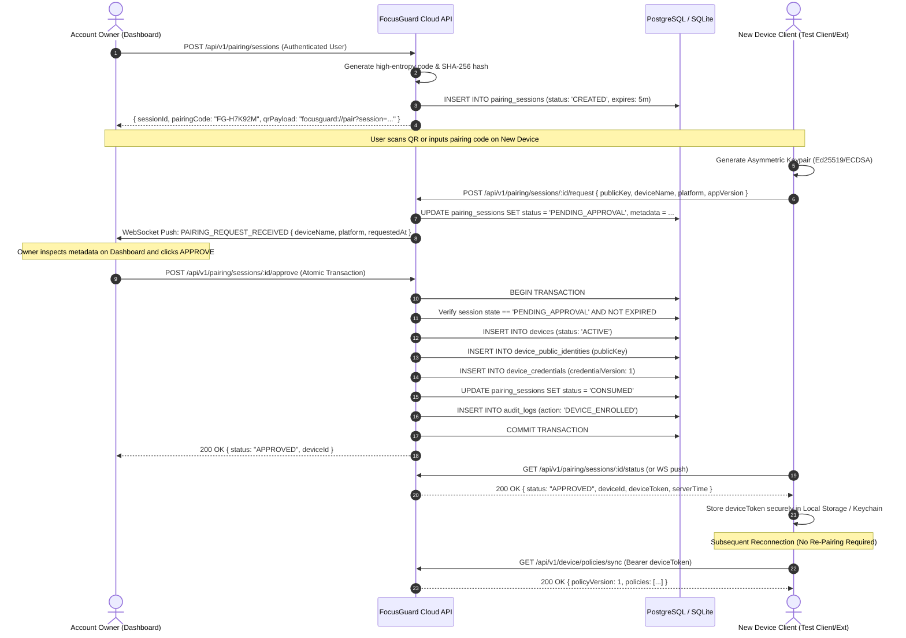

# FocusGuard Phase 2 Device Architecture & Trust Specification

**Document ID**: FG-ARCH-002  
**Version**: 2.0.0-PROD  
**Status**: APPROVED ARCHITECTURE  
**Target Clients**: Chrome Extension, Firefox, Edge, Brave, macOS Agent, Windows Agent, Android App  

---

## 1. Architectural Overview

FocusGuard Phase 2 establishes a cryptographically secure, zero-implicit-trust device management and pairing framework. Devices are never trusted merely because they share a local network, possess an IP address, or present an arbitrary device identifier. Trust is established strictly through **interactive pairing with explicit owner authorization** and maintained via **persistent, rotating, cryptographically bounded device credentials**.

```
                         ┌──────────────┐
                         │   Dashboard  │
                         └──────┬───────┘
                                │
                           User Auth (Bearer User JWT)
                                │
                                ▼
                     ┌─────────────────────┐
                     │  FocusGuard API     │
                     │                     │
                     │ Auth Service        │
                     │ Device Service      │
                     │ Pairing Service     │
                     │ Policy Service      │
                     │ Event Service       │
                     │ Realtime Gateway    │
                     └──────────┬──────────┘
                                │
                      PostgreSQL / SQLite WAL
                                │
              ┌─────────────────┼────────────────┐
              │                 │                │
              ▼                 ▼                ▼
       Browser Device     macOS Native    Android Future
       (Isolated Store)   (Secure Key)    (Keystore)
```

---

## 2. Trust Boundaries

FocusGuard enforces strict boundaries between different security zones:

```
┌────────────────────────────────────────────────────────────────────────┐
│ USER ZONE                                                              │
│ Dashboard / Management UI                                              │
│ - Identity: Authenticated User (Owner)                                 │
│ - Credential: Short-lived User Access Token + Rotating Refresh Token   │
│ - Permissions: Full administrative control over account & devices      │
└──────────────────────────────────┬─────────────────────────────────────┘
                                   │
                                   ▼
┌────────────────────────────────────────────────────────────────────────┐
│ API GATEWAY / SECURITY BOUNDARY (TLS 1.3 / HTTPS / WSS)                │
│ FocusGuard Cloud Backend                                               │
│ - Validates Request ID, Rate Limits, and Credentials                   │
│ - Evaluates Device Status (ACTIVE vs REVOKED/SUSPENDED)                │
│ - Enforces Scoped Ownership Isolation                                 │
└──────────────────────────────────┬─────────────────────────────────────┘
                                   │
                                   ▼
┌────────────────────────────────────────────────────────────────────────┐
│ DEVICE ZONE                                                            │
│ Browser Extension / macOS Agent / Windows Agent / Android App          │
│ - Identity: Unique Device ID + Asymmetric Keypair (Client-Generated)   │
│ - Credential: Encrypted Device Token (Restricted to Device Scopes)     │
│ - Local Storage: Isolated Extension Store / Platform Secure Keychain  │
│ - Permissions: Sync assigned policies, upload usage/events, heartbeat │
└────────────────────────────────────────────────────────────────────────┘
```

### Trust Boundary Invariants
1. **No Privilege Escalation**: A device token can NEVER access user management, account settings, or other devices' policies/events.
2. **Owner-Device Scoping**: Device $A$ owned by User $X$ can never read policies or ingest telemetry for User $Y$, or impersonate Device $B$.
3. **Private Key Non-Exportability**: Asymmetric private keys are generated on-device and NEVER transmitted across the network or stored on the server.
4. **Instant Revocation Cascade**: When an owner revokes a device on the Dashboard, the backend immediately marks credentials invalid and terminates active WebSocket sessions.

---

## 3. Device Lifecycle & Finite State Machine

```
              ┌──────────────────────┐
              │     UNREGISTERED     │
              └──────────┬───────────┘
                         │ Client initiates pairing request
                         ▼
              ┌──────────────────────┐
              │       PAIRING        │
              └──────────┬───────────┘
                         │ Client submits public key & metadata
                         ▼
              ┌──────────────────────┐
              │   PENDING_APPROVAL   ├────────────────────┐
              └──────────┬───────────┘                    │
                         │ Owner explicitly approves      │ Owner rejects
                         ▼                                ▼
              ┌──────────────────────┐         ┌──────────────────────┐
    ┌────────▶│        ACTIVE        │         │       REJECTED       │
    │         └────┬────────────┬────┘         └──────────────────────┘
    │              │            │
Heartbeat      Heartbeat        │ Owner revokes
restored       timeout          │ device
    │              ▼            │
    │         ┌──────────┐      │
    └─────────┤ OFFLINE  │      │
              └──────────┘      │
                                ▼
                      ┌──────────────────┐
                      │     REVOKED      │ (Terminal State)
                      └──────────────────┘
```

### State Machine Transition Rules
- `UNREGISTERED` $\to$ `PAIRING`: Session code entered or QR scanned.
- `PAIRING` $\to$ `PENDING_APPROVAL`: Device keypair generated; enrollment request submitted.
- `PENDING_APPROVAL` $\to$ `ACTIVE`: Owner clicks "Approve" in Dashboard.
- `PENDING_APPROVAL` $\to$ `REJECTED`: Owner clicks "Reject" or session expires.
- `ACTIVE` $\leftrightarrow$ `OFFLINE`: Governed by heartbeat presence (default: 3 minutes grace).
- `ACTIVE` / `OFFLINE` $\to$ `REVOKED`: Owner revokes device. Terminal state; no transitions out.

---

## 4. Secure Pairing Protocol Sequence



---

## 5. Token Architecture & Separation of Concerns

FocusGuard strictly partitions token lifecycles:

| Dimension | User Authentication | Device Authentication |
| :--- | :--- | :--- |
| **Issuer** | `/api/v1/auth/login`, `/register` | `/api/v1/pairing/sessions/:id/approve` |
| **Subject (`sub`)** | User UUID | Device UUID |
| **Claims** | `userId`, `email`, `role: OWNER` | `deviceId`, `userId`, `credentialVersion`, `role: DEVICE` |
| **Token Type** | `Bearer <user-jwt>` | `Bearer <device-credential-jwt>` |
| **Lifespan** | 15 minutes (Access), 30 days (Refresh) | Configurable rotating credential (e.g. 7 days or long-lived persistent key) |
| **Permissions** | Account, Dashboard, Billing, Device Admin | Heartbeat, Policy Pull, Event Batch Push, WebSocket Sync |
| **Revocation** | User Session Invalidation / Logout | Device Record status = `REVOKED`, Credential Version mismatch |

---

## 6. Offline & Interruption Behavior

- **Network Interruption During Pairing**: If connectivity drops during enrollment, the pairing session remains locked in `PENDING_APPROVAL` until the 5-minute timeout. The device retries status polling with idempotency.
- **Offline Enrolled Operation**: Enrolled devices cache verified policies locally. If cloud connectivity is lost:
  - Local DNR rules and domain matchers remain fully active.
  - Telemetry and block events accumulate in an encrypted local queue (`policyCache`).
  - Upon network reconnection, the client authenticates using its stored `deviceToken` and flushes accumulated events with idempotency keys.
  - No re-pairing is ever required following normal restarts or network dropouts.
- **Clock Skew / Anti-Replay**: Device events include client monotonic timestamps and server-validated UTC timestamps. Events outside acceptable skew tolerance are rejected.

---

## 7. Revocation Mechanics & Zero-Trust Enforcement

When an account owner clicks **Revoke Device**:
1. Server executes atomic revocation transaction:
   - Sets `devices.status = 'REVOKED'`.
   - Sets `device_credentials.revoked_at = NOW()`.
   - Records `audit_logs` entry: `DEVICE_REVOKED`.
2. Realtime hub (`events.Hub`):
   - Locates any active WebSocket connections bound to the `deviceId`.
   - Dispatches `DEVICE_REVOKED` command.
   - Forcefully severs the TCP connection.
3. Subsequent REST requests:
   - Device Auth middleware checks device status and credential version on **every single request**.
   - Any request bearing credentials of a revoked device is immediately rejected with HTTP `403 Forbidden` (`code: "DEVICE_REVOKED"`).
   - Re-activation is strictly prohibited. The device must be re-paired from scratch if desired.
